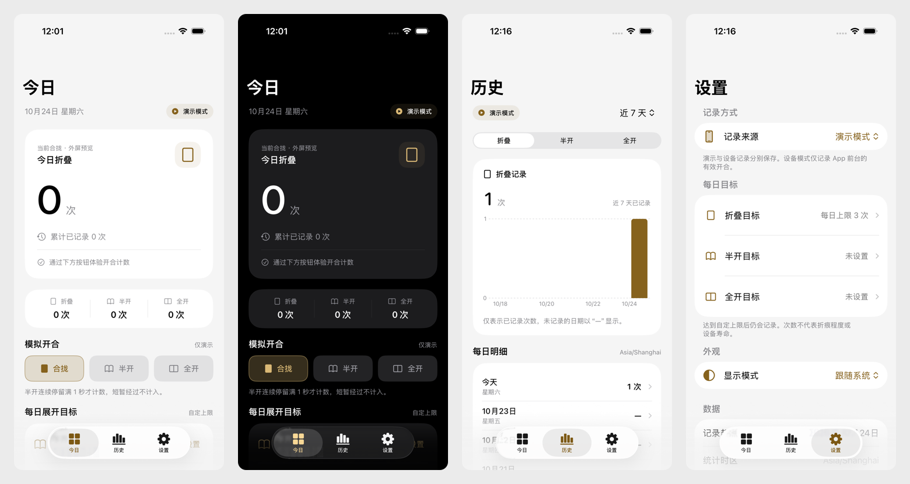

# 折记 / FoldLog（名称待定）

**仅支持 iPhone Duo** 的开合记录工具，发布版本要求 **iOS 27.1+**。提供可运行的 SwiftUI 原生体验版。

## 立即体验

使用 **Xcode 27.1 或更新版本**打开 [FoldLog.xcodeproj](FoldLog.xcodeproj)，选择 **FoldLog** 和具备 iOS 27.1+ 运行时的 iPhone Duo。无第三方依赖。

优先在 iOS 27.1 的 iPhone Duo 模拟器中体验内屏布局。若尚无 Duo 运行时，可双击 [启动设计预览](scripts/run-preview.command)，在普通模拟器中检查 UI；脚本会为 Debug 模拟器传入 `--design-preview`。手动调试时也可在 Xcode 的 Arguments Passed On Launch 添加此参数。普通机型不带参数启动会显示兼容提示；Release 不接受此预览参数。

设计预览初次启动进入演示模式：在“今日”点击 **半开 → 等待 1 秒 → 全开 → 合拢**，查看相应次数；在“设置”配置每日目标，在“历史”查看分类记录。首次在受支持 Duo 上运行默认进入设备记录。退出再打开会保留已有档案与记录模式。

## 体验版内容



- **今日**：三姿态对应的今日 / 累计次数、目标卡片、模拟开合。
- **历史**：7 / 30 天、分类图表、每日与事件明细。
- **设置**：三类独立目标、记录来源、浅色 / 深色、JSON 导出及确认清空；宽屏使用左侧分类与右侧详情分栏，窄屏使用完整表单。
- **计数**：半开连续满 1 秒才计入；短暂经过不计；半开确认后再全开分别各加 1。
- **数据**：本地原子保存；演示记录与设备记录各自独立。
- **小组件**：一个组件只展示剩余折叠次数；桌面仅小号，锁屏圆形 / 单行，轻点打开今日。无更新时间和演示角标。设置中可查看不同目标状态的样式与添加说明。
- **外观**：黑白金配色、SF Symbols、原生系统导航与表单；支持深色、辅助字号和宽屏双列布局。
- **Duo 适配**：主导航沿用系统自动的横纵排列；宽屏设置使用分类与详情分栏，目标编辑使用原生表单并保护未保存修改。
- **图标**：原创“暖白连页 00”，暖白底板、连续珍珠书页与可可灰双零；右侧数字以香槟金翻角点题，深色保持暖米灰底板，使用 Icon Composer 原生分层材质，见 [图标设计](design/app-icon/README.md)。

设备铰链入口在 iOS 27.1+ 启用；需要支持的设备实际提供数据。普通模拟器通过按钮演示，不代表真实 Duo 传感器。后台、锁屏、退出后的全天采集，以及真实内外屏切换仍待真机验证。

本轮包含普通 App 和 WidgetKit 桌面 / 锁屏小组件，不包含全局右侧栏或实时活动。小组件展示已保存统计，刷新由系统安排，不增加后台采集能力。目标是个人使用偏好，次数不能换算为折痕程度或硬件寿命。体验版暂不支持 JSON 导入恢复。

## 文档

- [Codex 交接上下文](docs/CODEX_HANDOFF.md)：另一台机器或另一个 Codex 的接续入口，包含已确认决策、验证结果和注意事项。
- [体验版运行说明](docs/体验版运行说明.md)：运行方式、实现范围、测试与限制。
- [桌面与锁屏小组件](docs/桌面与锁屏小组件.md)：添加方法、数据口径与工程配置。
- [精简组件实际桌面效果](artifacts/widget-remaining-home-system.png)、[浅色样式](artifacts/widget-remaining-light.png)、[深色样式](artifacts/widget-remaining-dark.png)、[锁屏样式预览](artifacts/duo-widget-remaining-lock-light.png)：仅显示剩余次数；图片为模拟器示例记录。
- [UI 视觉规范](docs/UI视觉规范.md)：黑白金配色、SF Symbols、原生组件与适配边界。
- [Duo 纵向导航与设置分栏](artifacts/duo-settings-split-light.png)、[原生目标表单](artifacts/duo-goal-form-light.png)：最新模拟器实际效果。
- [仅 Duo 兼容范围](docs/仅Duo兼容范围.md)：运行限制、开发预览和商店筛选验证边界。
- [产品规划 v0.10](docs/折叠计数App-产品规划.md)：规划、最新范围决策和后续验证。
- [计数与姿态展示规则](docs/计数与姿态展示规则.md)：已确认的转移和 1 秒规则。
- [全局右侧栏可行性](docs/纵向工具栏方案.md)：保留研究，已移出本轮实现。
- [开发可行性调研](docs/开发可行性调研.md)：Apple 文档、SDK 证据和真机验证任务。

## 验证

```sh
swift test
xcodebuild -project FoldLog.xcodeproj -scheme FoldLog \
  -destination 'generic/platform=iOS Simulator' \
  -derivedDataPath build CODE_SIGNING_ALLOWED=NO build
```

原生界面测试位于 `FoldLogUITests/`，使用独立测试数据目录；运行说明含测试命令。17 项核心、兼容策略与小组件数据测试通过，普通机型模拟器仅用于开发预览与限制验证，详见 [验证记录](artifacts/validation.md)。未发布 TestFlight 或 App Store。
