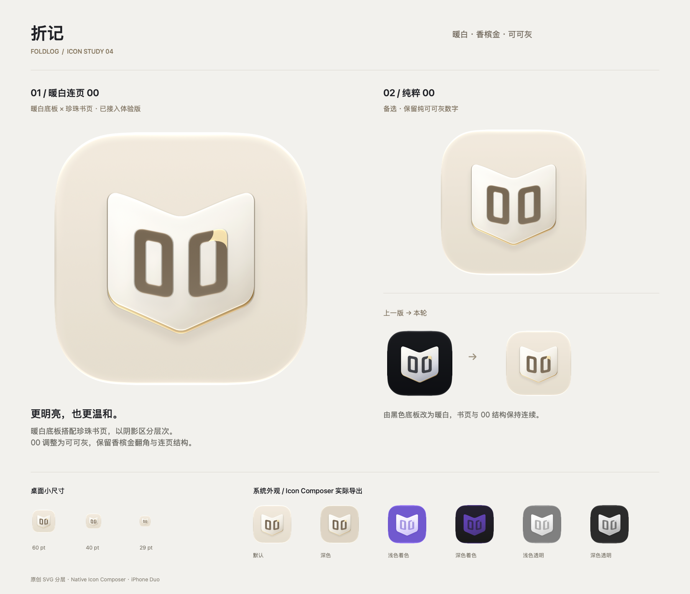

# 折记 · 暖白连页 00 App Icon

2026-10-24。当前主图标为第四轮「暖白连页 00」：暖白底板、完整相连的珍珠白书页、定制可可灰双零，以及右侧数字的香槟金翻角。工作名称仍可调整。



## 本轮设计

- **暖白连页 00（当前主图标）**：将黑底换成暖白 `#F1E9DC`，数字换成可可灰。书页仍为一条连续轮廓，中间没有分离的铰链条、接缝、高光线或白金拼接；金色保留在下缘和数字翻角。
- **深色外观**：独立设置暖米灰 `#DDD4C4` 底板，稍微降低亮度，保持书页与数字清晰。使用 Icon Composer 的实色深色填充，避免自动渐变在深色下生成黑底。着色、透明外观继续遵循系统与用户的个性化设置。
- **00 的处理**：原创路径绘制稍方的计数器字形，两位数字缩小间距，分别随书页微倾；第二个 0 上角翻出一段香槟金，提示翻页与递增。数字不是普通字体直接贴图，也不使用 SF Symbols。
- **纯粹 00（备选）**：保持同样的暖白连页结构和字形，移除数字上的金色翻角；未接入 App。
- 延续第二轮的柔和色面与材质；书页、数字、金色页缘各自分层，系统在这些轮廓上生成高光和阴影，中间书脊不形成独立材质边界。
- `00` 是静态的品牌计数符号，不代表当前真实次数；真实统计仍展示在 App 内。

## 工程与素材

| 文件 | 用途 |
| --- | --- |
| `../../FoldLog/FoldLogIcon.icon/` | **Xcode 当前使用的原生分层图标**；三张透明 SVG：数字、完整书页、金色下缘 |
| `v4-warm-ivory/connected-00/` | 当前主方向的源 SVG、可编辑 `.icon` 以及六种系统外观预览；`source-dark.svg` 用于深色备用 PNG |
| `v4-warm-ivory/plain-00/` | 暖白「纯粹 00」备选，含源 SVG 与 `.icon` |
| `v4-warm-ivory/icon-review.png` | 主方向、备选、新旧对照、60 / 40 / 29pt 缩小及六种系统外观 |
| `v4-warm-ivory/duo-home-screen.png` | iOS 27.1 / iPhone Duo 外屏主屏实际截图 |
| `v3-connected-zero/`、`archive-v3/` | 第三轮黑底「连页 00」与生成脚本归档 |
| `v2-fold-light/`、`archive-v2/` | 第二轮「折光」「对页」及其生成脚本归档 |
| `archive-v1/`、原有 A / B / C 目录 | 第一轮设计与绘制脚本归档 |

Icon Composer 导出 `default`、`dark`、`tinted-light`、`tinted`（深色着色）、`clear-light`、`clear-dark` 六种预览；预览带系统圆角与透明外缘，只用于检查，不当作无透明的 App Store 原图。着色和透明外观在实际桌面中的颜色受用户设置与壁纸影响。

原有 `AppIcon.appiconset` 同步保留 1024 × 1024、sRGB、无透明通道、未裁切圆角的静态 PNG；当前构建设置 `ASSETCATALOG_COMPILER_APPICON_NAME = FoldLogIcon`，实际使用 `.icon`。兼容提示页的 `BrandMark` 同步更新为透明的原创标记。

## 重建

在项目根目录运行（Python 3、Swift 与 Xcode 自带的 Icon Composer，无第三方包）：

```sh
python3 scripts/make-icon.py
swift scripts/make-icon.swift
```

前者生成 SVG、原生 `.icon` 与系统外观预览；后者生成静态备用资源、BrandMark 和对比图。修改构建配置后可运行 `python3 scripts/generate-project.py` 重建 Xcode 工程。旧轮次脚本归档仅供历史参考，运行会恢复旧版资产，勿用于当前素材重建。

构建与系统呈现的验证记录见 [验证记录](../../artifacts/validation.md)。模拟器不能替代真实设备上的动态光照体验。

UI/UX 图标素材检索未返回适合本项目的条目，构图和字形继续使用本项目的原创路径；HIG 用于分层、素材格式、缩小识别与外观检查。
