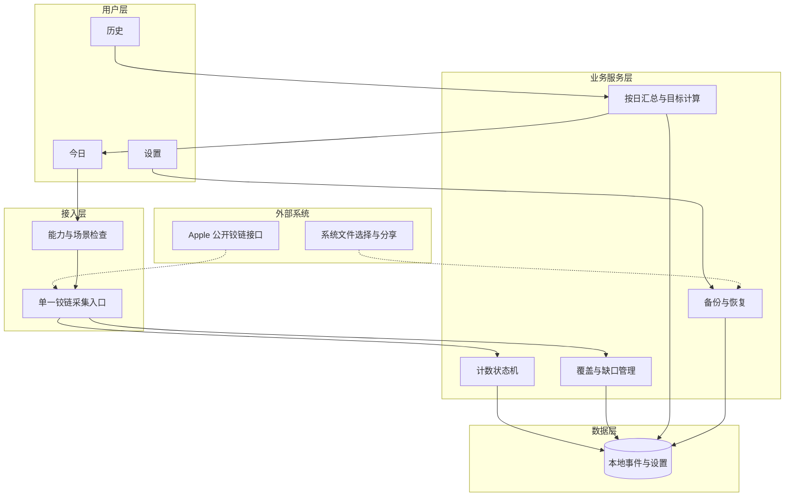
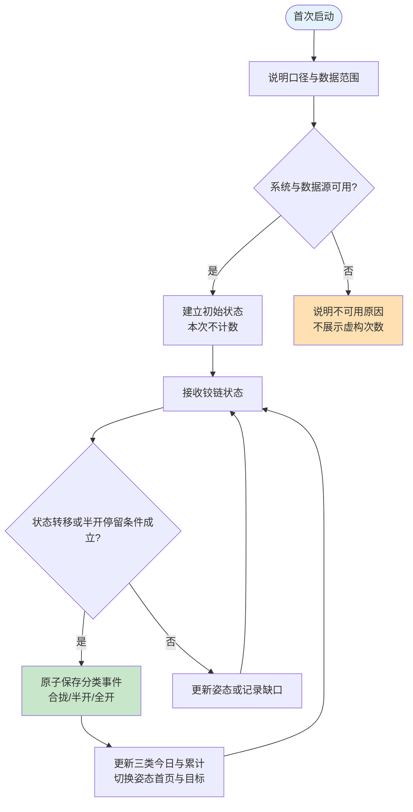
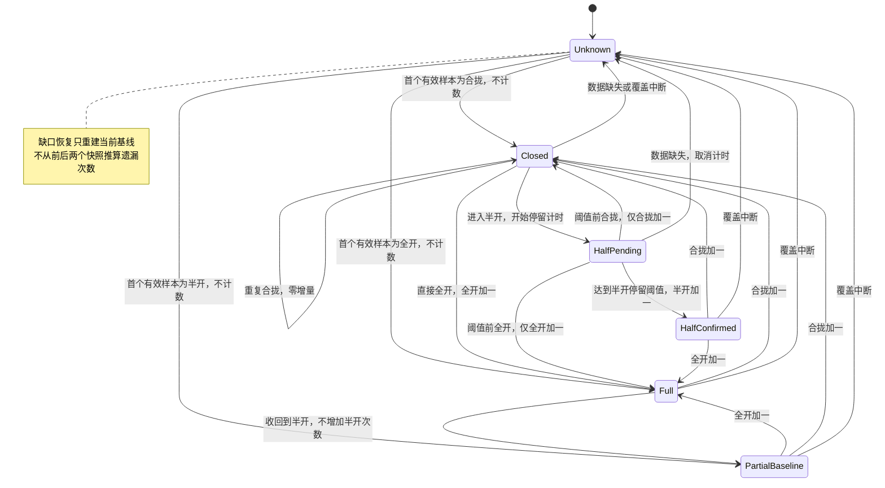
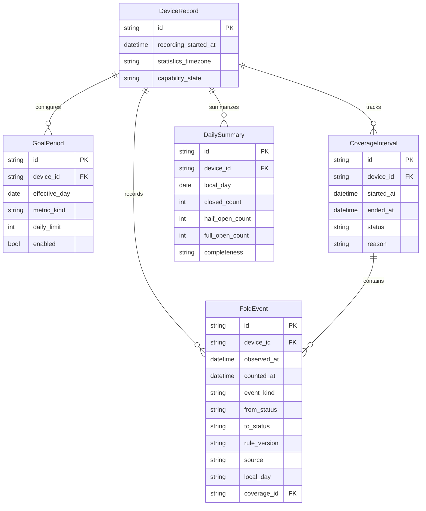

# 折叠计数 App 产品规划 / PRD 初稿

| 项目 | 内容 |
| --- | --- |
| 产品名称 | 待定；工作名“折记 / FoldLog”，未核验重名、商标与商店可用性 |
| 产品类型 | 面向公众上架的个人工具，先做精简首版；用户已确认 |
| 文档版本 | v0.9，2026-10-24 |
| 支持范围 | 仅 iPhone Duo；发布版本 iOS 27.1+；普通机型仅用于显式开启的 Debug 模拟器设计预览 |
| 需求方 | 项目发起人 |
| 编写 | Codex，根据本次沟通整理 |
| 审核人 | [TODO: 项目发起人指定] |
| 重要性 / 紧迫性 | 核心能力验证高；正式上线时间待验证后确定 |
| 当前状态 | 普通 App 体验版已增加用户追加的桌面 / 锁屏小组件；全天采集与 Duo 内外屏切换仍待真机验证 |

## PRD 修改记录

| 日期 | 版本 | 变更 | 修改人 | 审核 |
| --- | --- | --- | --- | --- |
| 2026-10-23 | v0.1 | 确定公众工具定位；核实 iOS 27.1 铰链接口；建立首版范围、计数口径和开发验证门槛 | Codex | 待评审 |
| 2026-10-23 | v0.2 | 按用户要求拆分合拢、半开、全开计数，按姿态切换内外屏信息；半开连续停留阈值确定为 1 秒 | Codex | 转移、姿态展示、1 秒阈值已由用户明确；展开目标配置仍待确定 |
| 2026-10-23 | v0.3 | 增加 Duo 纵向栏中的折叠、展开统计入口；核实 iOS 27.1 原生纵栏 API；计数规则不变 | Codex | 当时暂按 App 内范围规划；此假设已由 v0.4 替代 |
| 2026-10-23 | v0.4 | 按用户澄清改为跨 App 常驻系统右侧栏；核查 ActivityKit、WidgetKit 与 Controls；将尚无公开实现的需求和备选分开 | Codex | 全局常驻范围已明确；备选尚未选定 |
| 2026-10-23 | v0.5 | 用户接受先做普通 App；创建 SwiftUI 体验版，包含今日、历史、设置、模拟开合与独立设备记录入口 | Codex | 普通 App 优先方向已确认；全局栏不再阻塞体验版 |
| 2026-10-24 | v0.6 | 用户明确仅支持 iPhone Duo；增加机型入口限制，发布目标要求 iOS 27.1+；开始黑白金原创 App Icon 三稿设计 | Codex | Duo 专属范围已确认；图标首轮待体验反馈 |
| 2026-10-24 | v0.7 | 用户追加桌面 / 锁屏小组件；实现今日折叠、剩余 / 上限展示、跨日时间线及目标跳转 | Codex | 按用户授权自主实现，无需另行确认 |
| 2026-10-24 | v0.8 | 用户要求最小组件；桌面收敛为小号，锁屏保留圆形 / 单行 | Codex | 两种统计入口及目标跳转保持可用 |
| 2026-10-24 | v0.9 | 用户要求今日折叠与剩余合为一个组件；已折叠为主、剩余为次，附上限和进度 | Codex | 仅“今日折叠”入口；整体轻点进入今日，尺寸仍为桌面小号、锁屏圆形 / 单行 |

当前规则明细见 [计数与姿态展示规则](计数与姿态展示规则.md)。三类次数、姿态展示映射与“半开连续停留满 1 秒后计数”均已由用户明确。展开目标分设还是合并仍是配置决策，不影响这三类计数规则。

用户此前希望在其他 App 使用期间，系统右侧纵向栏仍常驻显示次数；目前未查到公开扩展接口。现已接受建议，明确先做普通 App 来体验。本轮实现今日、历史、设置三个页面，并按用户追加要求提供桌面 / 锁屏小组件；全局右侧栏和实时活动不纳入此体验版。小组件展示已有记录，不增加连续采集能力，细节见 [小组件说明](桌面与锁屏小组件.md)。调研结论仍见 [全局右侧栏需求与可行性](纵向工具栏方案.md)。

体验版运行与实际交付范围见 [体验版运行说明](体验版运行说明.md)。应用仅支持 iPhone Duo，发布版本要求 iOS 27.1+。iOS 26+ 的普通机型模拟器只用于显式开启的 Debug 设计预览，不构成对外兼容承诺。设备记录以 Duo 实际提供的数据为准。演示与设备记录分别保存，三类目标先独立配置、默认关闭；不把半开与全开合并成一个展开总数。机型白名单及商店筛选边界见 [仅 Duo 兼容范围](仅Duo兼容范围.md)。

## 1、项目背景

iPhone Duo 用户希望分别知道每天及累计的合拢、半开、全开次数，并设置每日目标。合拢时在外屏突出折叠次数和展开目标，半开或全开时在内屏突出相应次数和折叠目标；还希望在其他 App 中通过系统右侧常驻栏查看次数。需求起点是用户对折痕变化的关注；本产品将其转化为可查看的使用记录和自主习惯管理。

核心问题按优先级为：能否可靠采集日常折叠、能否满足跨 App 常驻展示；怎样让用户读懂今日与累计数据；怎样在不增加焦虑的情况下帮助用户设置目标。

**产品定位：为关心折叠频率的 iPhone Duo 用户，提供清楚、可信的折叠记录与每日上限管理。**

次数并不能直接代表折痕深度、屏幕健康或剩余寿命。目前没有这些换算的可靠依据，首版定位为使用统计工具。

## 2、需求基本情况

| 要素 | 内容 |
| --- | --- |
| 提出人 | 项目发起人 |
| 使用人 | 关心开合频率的 iPhone Duo 用户；偏好简单查看、无需频繁操作 |
| 受影响人 | 产品与研发团队、测试人员；不涉及多角色业务协同 |
| 使用频率 | 手机折叠随日常使用发生；查看 App 的频次待种子用户验证 |
| 核心痛点 | 用户不知道自己的折叠频率，也无法判断是否超过自行设定的每日范围 |
| 核心价值 | 降低记录成本，让数据来源、记录起点和遗漏范围清晰可见 |

典型场景：用户合拢手机后，在 App 的外屏前台界面看到今日折叠次数与展开目标；打开到半开时，内屏主数字切为半开次数，目标区域切为折叠目标；全开时，内屏主数字切为全开次数，继续显示折叠目标。每日及累计分类型展示。若当天存在未覆盖时段，页面说明“部分时段未记录”，不把它当作完整一天。内外屏切换能否保持 App 前台及交付事件须真机验证。

跨 App 场景：用户在浏览器、聊天等其他 App 中也希望直接看到右侧统计栏。该场景已确认属于需求，但目前没有查到相应公开实现接口；不能用本 App 内页面或工具栏的演示作为这一场景的验收证据。

目标场景：用户在设置页输入自己的每日上限。达到上限后，首页显示“已达到自定上限”，继续正常累计；次日按新的一天独立统计。该上限是个人偏好，不是硬件安全阈值。

## 3、商业分析

> 方法：先验证“可靠自动采集是否成立、用户是否愿意长期查看”，再验证付费。小工具的价值不以打开时长衡量。

| 维度 | 初步判断 |
| --- | --- |
| 目标市场 | 支持铰链接口的 iPhone Duo 用户；装机量与需求规模待调查，不作市场规模估算 |
| 主要用户 | 对使用习惯有记录需求的新机用户、折叠屏爱好者 |
| 核心卖点 | 简单查看折叠频率，明确数据覆盖范围，自己设置每日上限 |
| 首版收费建议 | 免费验证需求，无广告；稳定后再考虑一次性解锁增强功能 |
| 可付费方向 | 增强图表、主题、小组件样式；基础计数和数据导出保持可用 |
| 定价 | [TODO: 获取使用与付费反馈后决定，不预设月费或年费] |

参考方案比较如下，属于方案类型比较，不代表已经验证市场上的具体竞品能力：

| 方案 | 优点 | 局限 | 本产品需要验证的差异 |
| --- | --- | --- | --- |
| 通用手动计数器 | 简单、实现成熟 | 每次操作负担高，容易漏记 | 自动采集是否足够可靠 |
| 习惯打卡工具 | 目标与历史展示完整 | 与真实设备事件脱节 | 是否能直接反映手机的实际开合 |
| 系统自带相关统计 | 如存在，信任与触达有优势 | 本次未确认有面向用户的折叠历史统计 | [TODO: 真机调查系统设置和 App Store 同类工具] |

命名候选：“折记”偏记录；“开合”偏中性；“折数”偏功能；“FoldLog”可作为英文工作名。先用工作名推进验证，发布前再核验名称。

## 4、项目收益目标

以下为建议验收和验证目标，不是已取得的结果。

| 目标 | 衡量方式 | 阶段 |
| --- | --- | --- |
| 判断能否实现核心价值 | 分别给出数据采集能力矩阵与全局展示接口依据；目前后者未找到 | 能力验证结束 |
| 记录可信 | 所有页面展示记录来源与完整性；已知缺口不得显示为完整数据 | 首版验收 |
| 计数正确 | 合成事件覆盖关键边界；支持场景中人工标注样本精确率、召回率各 ≥99%，同时报告样本量 | 内测前，目标待真机校准 |
| 使用简单 | 首页直接看到今日和累计；不登录；目标设置不超过一个表单页 | 原型及内测 |
| 验证长期价值 | 建议邀请 10—20 位目标用户体验两周，记录持续查看意愿与信任问题 | 种子测试，招募后执行 |

运营成功标准建议：多数受访者能正确解释统计范围，且至少半数种子用户愿意继续使用。样本用于定性决策，不外推市场；营收目标在价值成立后制定。

## 5、项目方案概述

首版围绕“记录 → 查看 → 设置上限 → 回顾”形成闭环。采用 SwiftUI、本地存储优先，设备自动采集需要 iOS 27.1+；先验证底层采集再决定产品化。以下优先级为后续产品化规划，不表示本次体验版全部实现。当前体验版兼容 iOS 26+ 演示，采用本地 JSON，含导出、暂不含导入恢复；实际实现以运行说明为准。

| 优先级 | 模块 | 说明 |
| --- | --- | --- |
| P0 | 能力识别与覆盖说明 | 说明设备支持情况、记录起点、部分记录与不可用状态 |
| P0 | 分类型计数与姿态首页 | 合拢、半开、全开分别统计今日及累计；随姿态切换内外屏主数字和目标 |
| 后续研究 | Duo 全局右侧栏 | 当前无已查证的公开实现接口；用户已选择先做普通 App，不阻塞本轮体验版 |
| P0 | 每日目标 | 可选、自定义整数、默认关闭；首版建议沿用上限模式，具体指标配置见 10.2.3 |
| P0 | 基础历史 | 7/30 日与单日详情；按合拢、半开、全开筛选；缺口可见，不将未知显示为 0 |
| P0 | 本地保存与备份恢复 | 离线使用；同一设备记录的 JSON 备份及恢复 |
| P0 | 数据说明与管理 | 计数口径、隐私说明、清空记录、兼容性提示 |
| 追加实现 | 桌面与锁屏小组件 | 展示今日折叠及剩余 / 上限，使用已保存投影；系统调度刷新，不保证逐次即时更新 |
| P1 候选 | 通知、实时活动 | 数据能力成立且展示方向选定后再排期；实时活动不等于右侧永久常驻 |
| P1 | 手动修正与 CSV 导出 | 修正保留来源，不覆盖原始事件 |
| P2 | 云备份、年度报告、主题 | 待核心价值成立后评估 |

首版不引入账号、社交、排行榜、连续达标奖励、折痕识别、寿命预测、多设备混合累计或 AI 功能。通知、小组件的加入不能解决采集源缺失。

## 6、项目范围

| 涉及部分 | 关系与范围 |
| --- | --- |
| iOS App | 本项目主体；三个主页面和首次引导 |
| 系统级展示 | 用户追加桌面 / 锁屏小组件已实现；全局右侧栏及实时活动仍不在本轮范围 |
| Apple 铰链接口 | 已确认存在；正式使用范围须以实测能力为准 |
| 本地数据库 | 保存事件、每日目标、统计覆盖与备份信息 |
| 系统文件分享与导入 | 用户主动备份及恢复，不要求自建服务端 |
| App Store / TestFlight | 后续发布与内测渠道；本次规划未上传或提交任何应用 |

以一台手机的本机记录为数据边界。安装前数据、卸载后无备份的数据均不承诺恢复。读取机型或系统版本不等于成功取得传感器能力，实际回调需检查可用性。

## 7、项目风险

| 风险 | 影响 | 应对 |
| --- | --- | --- |
| 全局右侧常驻栏缺少公开实现依据 | 该展示方向暂不能实现 | 已确认先做普通 App；体验版不以跨 App 常驻作为验收项 |
| 只有视图实时事件，没有全天来源 | 用户核心诉求可能不成立 | 正式产品开发前设能力门槛；无法成立则重评产品方向 |
| 合拢导致场景/视图切换而漏掉事件 | 即使前台也可能漏记 | 真机逐次对照，核查事件与 scene 变更顺序 |
| 部分数据被误读为完整次数 | 趋势与目标结论失真 | 首页和历史显示覆盖范围；缺口日期不判“未超上限” |
| 将上限解释为安全次数 | 产生错误产品承诺 | 明确“自定上限”；不预填所谓推荐安全值 |
| 本地数据丢失或迁移混入旧设备 | 累计值不可信 | P0 备份恢复、版本校验；跨设备暂不合并 |
| 后台用途、商店描述与能力不符 | 影响审核与用户信任 | 用公开 API 和相符的后台用途；以实际支持范围描述功能 |
| 用户为了查看数据而反复开合 | 偏离产品目的 | 简单查看，不鼓励凑次数；后续考虑小组件 |

技术风险概率待验证，不用猜测的概率替代调研。前提是用户设备与系统支持公开接口，并且计数事件在目标使用场景中可可靠取得。

## 8、术语和缩略语

| 术语 | 本文定义 |
| --- | --- |
| 合拢 / 折叠次数 | 在连续可观测区间内，从已观测的半开或全开变为合拢，计一次；外屏产品文案可使用“折叠” |
| 半开次数 | 合拢到半开后，连续停留至少 1 秒计一次；经过半开不足 1 秒的过程不计 |
| 全开次数 | 合拢或半开到全开计一次；经过半开的直接全开路径只记全开，不补记半开 |
| 累计已记录 | 当前设备、自开始记录以来按合拢、半开、全开分别保存的次数，不等同出厂累计 |
| 每日上限 | 用户自行设定的每日次数偏好；并非硬件安全指标 |
| 记录覆盖 | 该时段是否有经验证可用的数据源；进程存活时长不能直接代表覆盖 |
| 能力验证 | 最小工程验证 API 与场景表现，先于完整 UI 开发 |

## 9、参考文献和引用文档

详细来源、SDK 检查结果、限制与验证清单见 [开发可行性调研](开发可行性调研.md)。主要依据：

- [Apple UIHinge](https://developer.apple.com/documentation/uikit/uihinge)。
- [Apple UIHingeInteraction](https://developer.apple.com/documentation/uikit/uihingeinteraction)。
- [Apple SwiftUI onHingeChange](https://developer.apple.com/documentation/swiftui/view/onhingechange(isenabled:_:))。
- [Apple Background Tasks 策略](https://developer.apple.com/documentation/backgroundtasks/choosing-background-strategies-for-your-app)。
- [App Review Guidelines](https://developer.apple.com/app-store/review/guidelines/)，发布前按最新规则复核。

## 10、功能需求

### 10.1 产品框架

> 方法：先定义数据事实与计数口径，再设计页面。界面不能把缺失的事件变成确定的统计结论。

#### 应用架构

| 层 | 实现建议 |
| --- | --- |
| 页面 | SwiftUI，使用场景生命周期；合拢为外屏首页，半开/全开为内屏首页；不将 App 内纵栏当成全局常驻实现 |
| 系统展示 | 目前无右侧常驻栏公开接口依据；若后续选用 ActivityKit / WidgetKit，另设展示适配层并读取已保存统计，不兼任采集源 |
| 接入 | 首版优先 `onHingeChange`；UIKit 接口用于交叉验证，正式计数只保留一个来源 |
| 业务 | 独立纯逻辑计数器，接收归一化状态，不依赖页面按钮或图表 |
| 存储 | 首版建议 SwiftData 本地存储；事件与状态采用事务更新 |
| 后台 | 仅使用与用途相符、经验证的能力；不可用区间显式记录 |

#### 核心流程

| 步骤 | 用户参与 |
| --- | --- |
| 首次启动 | 阅读简短说明，可跳过设置上限 |
| 正常记录 | 在已验证支持的场景内自动记录；缺口可见 |
| 查看与回顾 | 今日、累计、历史均带数据范围说明 |
| 不支持 | 给出原因与已有记录入口，不诱导用户购买无法实现的功能 |

#### 计数状态机

| 场景 | 合拢增量 | 半开增量 | 全开增量 | 处理 |
| --- | --- | --- | --- | --- |
| 首次进入或缺口恢复时已处于某姿态 | 0 | 0 | 0 | 只建立基线，不把当前快照当作刚发生的动作 |
| 合拢 → 经过半开 → 全开 → 合拢 | 1 | 0 | 1 | 半开停留未达阈值 |
| 合拢 → 停留半开 → 全开 → 合拢 | 1 | 1 | 1 | 半开停留已达阈值 |
| 合拢 → 短暂半开 → 合拢 | 1 | 0 | 0 | 合拢计数不以半开次数已确认为前提 |
| 合拢 → 停留半开 → 合拢 | 1 | 1 | 0 | 半开只确认一次 |
| 合拢 → 全开（未交付中间状态） | 0 | 0 | 1 | 不人为补造半开事件 |
| 全开 → 半开 | 0 | 0 | 0 | 按用户列出的规则，只切换半开首页，不新增半开次数 |
| 全开 → 半开 → 全开 | 0 | 0 | 1 | 半开到全开记一次全开 |
| 相同姿态反复回调 | 0 | 0 | 0 | 不以回调次数计数，也不重启半开计时 |
| 观测中断，恢复时已合拢 | 0 | 0 | 0 | 标记缺口，不推测中间经过哪些姿态 |

HalfPending/HalfConfirmed/PartialBaseline 是 App 的计数上下文，不是 Apple 新增的物理状态。**半开连续停留阈值为 1 秒，已由用户确定，属于 App 的业务规则。** 半开期间可以立即切换内屏半开首页，次数达到停留条件后再增加；不足 1 秒即转全开无需等计时结束。进入全开后不追溯补记半开；达到 1 秒已计入的半开不因随后全开而撤销。

系统状态可能受姿态影响。使用系统 status，不设未经验证的角度区间；停留计时使用单调时钟且独立于回调频率，仅在连续有效覆盖内成立。状态变化、nil/unknown、覆盖中断都取消待确认计时；同一次停留最多记一次半开。全开与合拢的状态去抖参数另行由真机校准，不能把真实的反向转移全部吞掉。

#### 最小数据模型

| 实体 | 关键约束 |
| --- | --- |
| DeviceRecord | App 内记录档案 ID，不依赖获取设备序列号；首版一个当前档案 |
| FoldEvent | `event_kind` 为 closed / half_open / full_open；保存转移观测时间、业务计数确认时间、转移状态、口径版本、来源、覆盖与去重信息；半开确认时间为达到停留阈值的时刻 |
| GoalPeriod | 按 `metric_kind` 指定目标统计指标；展开目标的配置口径仍待确认；`daily_limit` 为正整数，建议输入范围 1—9999，属于表单限制；关闭不使用 0 表示 |
| CoverageInterval | covered / gap / unknown；只对已验证的来源标 covered，缺口保存原因 |
| DailySummary | 合拢、半开、全开分开汇总，不将三者相加称作开合周期；以原始事件为准，可重建；与 `(device_id, local_day)` 唯一对应 |

新增事件、计数器检查点和汇总更新需保持一致。多视图不得各自新增记录；重复导入按事件 ID 去重。回调缺少系统事件 ID 时，采集入口生成本地事件 ID 并串行处理；不能仅用“同一秒”去重，以免吞掉真实事件。

### 10.2 页面与业务规则

#### 10.2.1 首次引导与能力状态

流程：打开 App → 解释合拢、半开（停留满 1 秒）、全开的计数含义 → 检查系统与运行时数据源 → 可选设置每日目标 → 进入对应姿态的今日页。

引导仅一屏主体说明加可选设置，核心文案为“记录手机开合，了解自己的使用频率”。同时说明记录起点与当前支持范围；不要求用户主动开合来完成打卡。

| 状态 | 展示与动作 |
| --- | --- |
| 初始化中 | “正在读取设备状态”，不先显示 0 次 |
| 当前可记录 | 说明已验证可记录的场景，进入首页 |
| 暂时无法读取 | 提示“当前无法读取折叠状态”，保留历史，重试建立基线 |
| 设备或系统不支持 | 显示最低系统要求与支持情况，可查看已有记录和数据说明 |

`hinge == nil` 可能由视图层级变化引起，单次缺失不能立即断言设备永久不支持。区分系统版本不支持、已知设备能力与暂时无数据。

#### 10.2.2 今日页

流程：读取三类本地汇总 → 检查当前数据源与覆盖 → 按姿态展示主数字和目标 → 有效转移或半开停留确认后更新。

| 当前姿态 | 显示位置 | 主数字 | 目标区域 |
| --- | --- | --- | --- |
| 合拢 | 外屏，App 前台界面 | 今日折叠次数，及同类型累计 | 展开目标，包含半开与全开；分设或合并口径见 10.2.3 |
| 半开 | 内屏，App 前台界面 | 今日半开次数，及同类型累计 | 折叠目标，对应合拢次数 |
| 全开 | 内屏，App 前台界面 | 今日全开次数，及同类型累计 | 折叠目标，与半开页共用同一个合拢目标 |

姿态页切换只改变展示，不清空次数、不新增目标、不重置计时。半开页可在进入半开后显示，但不到 1 秒不增加半开次数；页面应让“当前半开姿态”与“今日半开计数”分别可辨。

| 页面元素 | 示例与规则 |
| --- | --- |
| 日期 | 今天，10 月 23 日 |
| 主数字 | 合拢时“今日折叠 32 次”；半开、全开时换成对应类型的今日次数 |
| 每日目标卡片 | 合拢时展示半开/全开目标；半开或全开时展示同一个折叠目标，标明指标名称 |
| 使用比例 | 32 / 60 = 53%；用“上限使用”而非“完成目标” |
| 累计卡片 | 明确标注“累计折叠 / 累计半开 / 累计全开”；不将三类相加叫累计折叠 |
| 记录状态 | “当前正在记录 / 部分时段未记录 / 当前无法读取” |
| 最近更新 | 最近一次有效状态时间；不能表示后台持续采集承诺 |
| 历史入口 | 最近 7 日简图或“查看历史” |
| Duo 全局右侧栏（未实现） | 需在其他 App 中常驻显示折叠、展开次数；本页 UI 与 App 内工具栏不能满足，详见独立可行性说明 |

全局右侧栏是跨 App 的独立展示需求，目前没有查到相应公开实现接口。此前 App 内纵向工具栏探针仅证明本 App 的 API 调用可通过类型检查，不满足用户已澄清的范围。灵动岛 / 锁屏实时活动、桌面 / 锁屏小组件仅列备选，不能自动替换为首版方案。半开 1 秒规则和三类计数保持不变；展开合并口径未定前分别展示半开与全开。详见 [全局右侧栏需求与可行性](纵向工具栏方案.md)。

操作：设置或修改上限；点击记录状态查看说明；点击历史进入单日详情。首版不提供常驻手动“+1”主按钮。

| 规则类型 | 规则 |
| --- | --- |
| 计算 | 按 event_kind 分别计算当前统计日内有效事件数和当前设备累计；半开只包含连续停留满 1 秒后确认的事件 |
| 计算 | 剩余 = max(上限 − 已记录次数, 0)；超过值 = max(已记录次数 − 上限, 0) |
| 约束 | 比例显示可超过 100%；进度条长度最多 100%，超出次数用文字说明 |
| 触发 | 已记录数 ≥ 上限时，显示“已达到自定上限”；超过时仍继续记录 |
| 推论 | 部分记录已达到上限，足以判断达到；部分记录低于上限，不能判断全天未超上限 |
| 约束 | 有缺口时优先显示“已记录 X 次，部分时段未记录”；不显示可信度百分比或虚假精度 |

使用中性文案与轻提示，不用“寿命减少”“屏幕危险”等推断，不阻止系统折叠或其他 App 使用。

#### 10.2.3 每日目标与上限建议

用户已明确目标区域随姿态切换的映射；首版建议仍采用可选的每日上限模式，用户可以跳过和关闭。折叠目标统计合拢次数，半开与全开内屏页共用此目标，不按页面各存一份。

外屏“展开目标（半开、全开）”的配置仍待确定：建议半开、全开各有一项进度；若选择合并为一个目标，必须先明确是“姿态次数之和”还是“每次从合拢打开去重一次”。一次半开满 1 秒后再全开会让两类各加 1，因此不能在未定义口径时直接将两类相加称为“打开了两次”。当前数据模型先保留分类型指标，不承诺合并目标。

建议配置流程：选择指标 → 开启上限 → 输入正整数 → 预览“每日不超过 X 次” → 保存。分设或合并的配置决定前，不把此建议当作已确认需求。

| 设置项 | 默认与行为 |
| --- | --- |
| 开启上限 | 默认关闭，避免替用户给出所谓安全次数 |
| 统计指标 | 折叠为合拢次数；半开、全开各自独立；外屏目标配置口径待定 |
| 次数 | 对每个已启用指标输入整数，无预填安全建议 |
| 生效日期 | 初次设置可当天生效；后续修改默认次日生效，保存时明确展示 |
| 关闭 | 当天立即关闭并保存变更记录；已结束日期的目标不重写 |
| 结果表达 | “未超过自定上限 / 已达到 / 已超过 / 数据不完整，无法判断” |

历史日期使用该日生效的目标版本；当天尚未结束时不判最终结果。目标未开启时展示次数即可。内页说明“这是个人使用偏好，不能据此判断折痕或设备寿命”。

#### 10.2.4 历史页

流程：选择合拢 / 半开 / 全开类型与 7 日或 30 日 → 查看每日柱状图 → 点选某日查看对应次数、上限、来源和覆盖区间。

| 要素 | 规则 |
| --- | --- |
| 查询条件 | 7 日默认、可切 30 日；三类指标可切换，不随当前姿态强制改变用户选中的历史类型；单设备、固定统计时区分日 |
| 每日柱 | 所选类型的有效记录次数；不堆叠为开合周期；部分日期使用不同样式并附文字标识 |
| 无数据日期 | 展示“— / 未记录”，不参与完整日平均值或目标判断 |
| 当天详情 | 日期、三类已记录次数、相应当日目标、覆盖/缺口说明、记录来源、计数规则版本 |
| 平均值与比较 | 首版可省略；若显示，仅用完整、口径一致的日期，并显示样本天数 |

不对数据缺口进行线性补齐，不按两次打开 App 之间的累计差任意分摊每日次数。暂不做“连续 X 天达标”激励。

#### 10.2.5 设置、备份与恢复

流程：设置页 → 选择上限、数据说明或数据管理 → 执行操作并显示结果。

| 入口 | 功能 |
| --- | --- |
| 每日目标 | 查看各指标当前与待生效配置；半开与全开页共用折叠目标 |
| 记录说明 | 三类转移口径、半开满 1 秒规则、统计起点、当前覆盖边界 |
| 统计时区 | 首次采用设备当前时区，之后固定；首版显示此设置，暂不允许改写历史时区 |
| 导出备份 | 用户主动导出带 schema 版本、记录档案、事件和目标的 JSON 文件 |
| 恢复备份 | 校验文件结构、版本与档案 ID；预览合并数量，按事件 ID 去重，事务提交 |
| 跨设备备份 | 首版拒绝合并到当前设备累计；说明尚不支持跨设备汇总 |
| 清空记录 | 明示清除范围并二次确认；先提供导出入口，成功后建立新记录档案 |
| 隐私与反馈 | 说明本地处理和备份文件内容，用户自行决定反馈哪些诊断信息 |

保存失败时展示最后成功保存的数据，不让内存中未保存的次数冒充持久记录。备份恢复的原始数据与汇总需一致，不能只恢复今日数字。

### 10.3 日期与异常处理

日期采用固定统计时区和公历自然日，事件存储 UTC；各类型按事件成立的 counted_at 归属。合拢与全开按确认转移的时间，半开按连续停留满 1 秒的确认时间；例如午夜前进入半开、午夜后才满 1 秒，半开计入新一天。新一天通过时间范围查询产生，不清零原始事件；前台停留跨日与重新进入时都重新计算。首版不因旅行自动改写历史时区。

| 异常 | 处理 |
| --- | --- |
| 断网 | 核心计数、目标与历史本地可用；远程说明打不开时展示已保存说明 |
| 铰链变 nil、状态 unknown、scene 中断 | 终止当前确定覆盖区间，取消半开待确认计时并清除连续转移上下文；恢复后只建立基线，不跨缺口凑满 1 秒 |
| App 意外终止或强制退出 | 启动时把未正常结束的区间标为未知；不把崩溃前后的时间差当作完整覆盖 |
| 开合跨越午夜 | 各类型在自身确认时间所属日期 +1；所有累计均不重置 |
| 内外屏切换或视图重建 | 复用同一统计存储与目标；不得因页面首次出现而加数，切换期间无有效数据则标记缺口 |
| 用户调整系统时间 | 使用单调时间保证事件顺序；标记时钟异常供诊断，不重算成额外事件 |
| 回调并发、多视图观察 | 统一采集入口与串行写入，不允许各页面自行加次数 |
| 状态抖动 | 根据真机日志校准，合成事件回归；不按角度微小变化累加 |
| 数据库写入失败 | 保留最后成功值并提示保存失败，重试必须保持幂等 |
| 备份损坏、不兼容或重复导入 | 导入前校验；失败不修改原库，重复事件不重复累计 |
| 通知未授权 | P1 通知不可用；App 内上限展示正常，不反复索取授权 |

### 10.4 开发顺序与进入条件

| 阶段 | 交付物 | 进入下一阶段条件 |
| --- | --- | --- |
| 第 0 阶段：能力验证 | 最小诊断界面、原始日志、场景矩阵、数据源及系统展示结论 | 普通 App 优先方向已确认，可并行开发演示体验版；发布自动计数前仍需明确采集范围 |
| 第 1 阶段：交互原型 | 今日 / 历史 / 设置及不可用、缺口、超限状态；选定后再加入系统展示 | 用户可理解计数与目标；原型须注明哪些界面属于已选实现，不能把全局栏概念稿当成可运行能力 |
| 第 2 阶段：首版实现 | 计数器、本地保存、目标、历史、备份恢复 | 测试覆盖计数、跨日、缺口、重启、备份一致性 |
| 第 3 阶段：种子内测 | TestFlight 包、反馈记录、能耗与准确性报告 | 支持范围稳定，宣传与能力一致，再确定上架计划 |

此前 3—4 个工作周的初步估算仅针对本地计数与三页 App：约 2—3 个工作日验证、2—3 个工作日原型、5—8 个工作日实现及 3—5 个工作日测试，前提是单人熟悉 iOS、数据源成立且设备到位。此估算不包含尚无公开实现的全局右侧栏；展示方向确定后须重估。获取设备、系统安装、商店素材、付费功能和审核等待另计，不能作为当前完整需求的交付承诺。

## 11、数据埋点

首版本地记录必要的产品事件，默认不把折叠明细或用户行为发送到自建服务器。诊断数据由用户主动导出；指标不足时用种子用户访谈与自愿反馈补充，不声称已有线上留存统计。

| 事件 | 参数建议 | 用途 |
| --- | --- | --- |
| page_view | today / history / settings | 核心页面的使用情况 |
| capability_checked | 系统版本、结果、缺失原因 | 区分不支持与暂时无数据 |
| onboarding_completed | 是否开启上限、流程耗时 | 判断首次设置是否过重 |
| daily_limit_saved | 开启状态、生效日期 | 判断上限功能采纳 |
| coverage_gap_detected | 开始/结束时间、原因类别 | 定位记录中断 |
| backup_completed / restore_completed | 成功与否、耗时、schema 版本 | 数据保护能力与失败定位 |
| storage_failed | 错误类别、版本 | 排查数据保存问题 |

诊断构建可额外保存原始铰链样本、scene 状态与单调时间；正式版本不持续保存高频角度流。产品验证关注“是否理解统计范围、是否仍愿意使用、是否信任次数”，不以用户多折叠或多打开 App 为目标。

## 12、角色和权限

仅有本机使用者，无账号与管理后台，不引入 RBAC。

| 能力 | 首版权限处理 |
| --- | --- |
| 铰链状态 | 按已查公开 API 使用；本次文档未给出专用授权弹窗，不自行杜撰；正式接入时复核最新要求 |
| 读取本地记录、改上限 | App 内操作，无额外系统权限 |
| 导出或导入 | 使用系统文件交互，由用户选择文件与位置 |
| 通知 | P1；用户开启提醒时再请求，拒绝后不影响记录展示 |
| 账号、定位、通讯录、相机、麦克风 | 当前方案不需要 |

隐私说明应明确记录的次数、时间、目标和备份内容，以及本地存储范围。文件可能包含使用时间信息，导出时让用户了解文件内容。若以后加入云同步或第三方统计，单独更新数据流程和商店隐私说明。

## 13、运营计划

| 阶段 | 范围与目的 | 不满足条件时 |
| --- | --- | --- |
| 能力验证 | 开发人员与可用真机，验证全天来源、前台事件完整性与系统展示依据 | 重评产品方向；全局右侧栏或采集来源未满足时不承诺完整需求可交付 |
| 原型走查 | 项目发起人与少量目标用户，确认信息能否读懂 | 修正统计文案与交互 |
| 种子内测 | 建议 10—20 位正常使用手机的用户，观察约两周 | 优先修复漏记、覆盖误解和数据丢失问题 |
| 正式上架 | 能力与质量门槛通过后确定地区、素材与版本 | 保留受控测试版本，暂缓正式发布 |

发布材料重点展示次数、历史和自定上限；准确说明支持的系统、设备、使用场景和记录起点。仅在能力验证通过后使用“自动记录”宣传，并同时写明范围。

获客初期可面向折叠屏爱好者和独立 App 用户介绍实际功能，通过真实使用反馈验证需求。先完成免费首版，避免在数据可靠性未验证时引入订阅。反馈入口先采用用户主动复制诊断或自行发送，不自动上传日志。

## 14、待决事项

| 编号 | 待决事项 | 负责角色 | 决策时点 | 当前建议 |
| --- | --- | --- | --- | --- |
| D1 | 是否存在可满足全天统计的公开数据源 | iOS 研发，[TODO: 指定人员] | 完整产品开发前 | 最高优先级；按调研清单验证，不预设成立 |
| D2 | 若只能前台或部分记录，是否仍产品化 | 项目发起人 | D1 后 | 先做价值访谈；全天自动卖点暂停，手动工具另立方向 |
| D3 | 三类计数的实际交付与状态去抖参数 | 研发 / 测试 | 真机验证后、实现前 | 用户已明确转移及半开满 1 秒规则；验证计时和内外屏切换，不改变已确认口径 |
| D4 | 正式名称、中文与英文显示名 | 项目发起人 | 商店素材前 | “折记 / FoldLog”仅作工作名，需检索名称与商标 |
| D5 | 首发地区、语言、对外支持机型 | 项目发起人 / 研发 | 内测后、上架前 | 首版中文、iOS 27.1+，以真机能力矩阵为准 |
| D6 | 后续付费方式与价格 | 项目发起人 | 核心价值验证后 | 首版免费，无广告；优先考虑一次性增强功能 |
| D7 | 种子用户招募与最终验收目标 | 项目发起人 / 测试 | 内测前 | 10—20 位、两周正常使用；准确率须有样本与场景说明 |
| D8 | 外屏展开目标分设还是合并 | 项目发起人 | 目标配置原型前 | 建议半开与全开分设进度；如合并必须明确去重打开或姿态次数之和 |
| D9（已决） | 全局右侧栏缺少公开接口时的产品方向 | 项目发起人 | 已确认 | 用户已接受先做普通 App 体验版；全局栏、实时活动和小组件留待后续，不阻塞本轮 UI |

## 附：自检与待完善清单

### 重大风险快扫

| 风险 | 结果 |
| --- | --- |
| 产品定位 | 已覆盖；公众个人工具，目标是可信使用记录 |
| 核心流程 | 已定义；普通 App 优先已确认，全天采集仍是自动统计发布门槛 |
| 数据模型 | 已给出轻量模型；工程实现时细化事务和去重方式 |
| 权限边界 | 已定义单用户、按需权限，无管理后台 |
| 功能致命缺口 | 已识别：全局右侧栏无公开实现依据；实时铰链接口不能自动证明历史回补或全天记录 |
| 需求匹配 | 已定义每日、累计、目标与全局栏要求；后者未满足，无硬件健康换算 |
| 平台与隐私 | 已列约束；正式发布前按实际能力及最新规则复核 |
| SaaS 多租户 | 不适用 |

### 14 维度检查

| 维度 | 完成度与下一步 |
| --- | --- |
| 业务分析 | 已定义痛点；需真实用户验证需求强度 |
| 类型适配 | 已按面向公众的个人工具简化，无企业审批流程 |
| 定位 | 已明确使用记录与上限管理；全天来源未验证 |
| 用户旅程 | 覆盖首次设置、日常查看与回顾 |
| 文档结构 | 14 章完整，未确认项集中在第 14 章 |
| 架构 | 已分离采集、计数、展示与存储；先验证接入层 |
| 数据建模 | 已定义事件、目标、覆盖与汇总；需细化工程 schema |
| 流程与角色 | 已给核心流程与状态机；单用户权限 |
| 交互 | 已列页面、空态、缺口、超限；待制作可交互原型 |
| 商业分析 | 方案比较与收费方向已给；无实测市场规模和具名竞品调查 |
| MVP | 已设 P0/P1/P2 与进入条件；全局栏缺口不作为已可交付功能 |
| 异常处理 | 覆盖缺口、并发、跨日、存储、备份与生命周期 |
| AI 功能 | 不适用 |
| 运营与评估 | 已给种子测试与发布门槛；负责人和具体排期待指定 |

### 必须补齐：影响正式开发决策

1. **真机支持矩阵与全天数据源结论**：由研发完成第 0 阶段；缺少它就无法承诺核心自动统计体验。
2. **合拢事件交付与去抖证据**：核对场景变更和回调顺序，以日志确定可统计范围及口径。
3. **研发与测试负责人**：由项目发起人指定后安排具体日期，避免把工作量估算误当交付承诺。
4. **全局展示方向（本轮已决）**：用户已选择先做普通 App，不作为体验版门槛；以后恢复系统展示需求时再单独核查接口。

### 建议补齐：提高需求与上线质量

1. 使用正常手机习惯采访目标用户，并调查系统自带能力、App Store 同类工具与名称冲突。
2. 根据能力验证结果制作三页原型，走查覆盖提示和上限文案是否容易理解。
3. 内测前落实支持机型、种子用户、数据备份恢复验收与能耗基线。

### 可选完善

桌面 / 锁屏小组件已按用户追加要求实现；通知、视觉主题、付费策略与云备份在首版价值成立后再定。完成上述核心验证后再进行完整需求评审。
